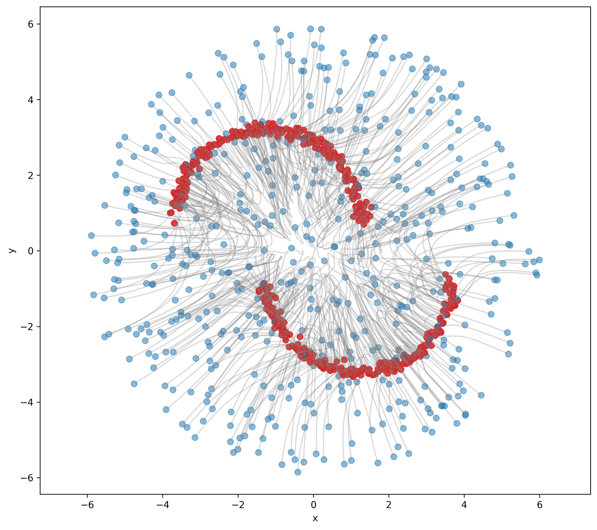

# Drift Flow Matching

**NeurIPS 2026** · Chenrui Ma, Xi Xiao, Lin Zhao, Tianyang Wang, Ferdinando Fioretto, Yanning Shen

[Project page](https://merry7cherry.github.io/drift-flow-matching/) · [Paper](https://arxiv.org/abs/2605.17244)

Drift Flow Matching (DFM) learns transport between pairs of intermediate marginal distributions using a distribution-level drift objective. A two-time model supports direct one-step generation and multi-step refinement with the same parameters.



## Start here

Use Python 3.11. Clone the repository, then choose a module below:

```bash
git clone https://github.com/merry7cherry/drift-flow-matching.git
cd drift-flow-matching
```

| Module | Workflow | Start |
| --- | --- | --- |
| **Image generation** | Prepare MNIST / FFHQ latents, train DFM, sample and evaluate | [Installation and dataset guides](image_generation/README.md) |
| **Generation trajectories** | Run a CPU demo, then compare DFM, Flow Matching and MeanFlow | [Generate your first figure](generation_trajectory/README.md) |

## Citation

```bibtex
@article{ma2026drift,
  title   = {Drift Flow Matching},
  author  = {Ma, Chenrui and Xiao, Xi and Zhao, Lin and Wang, Tianyang
             and Fioretto, Ferdinando and Shen, Yanning},
  journal = {arXiv preprint arXiv:2605.17244},
  year    = {2026}
}
```

## License and acknowledgements

DFM code and documentation use the [MIT License](LICENSE). The FFHQ integration builds on [ALAE](https://github.com/podgorskiy/ALAE) and retains its Apache 2.0 license and copyright notices; see [third-party notices](THIRD_PARTY_NOTICES.md).
